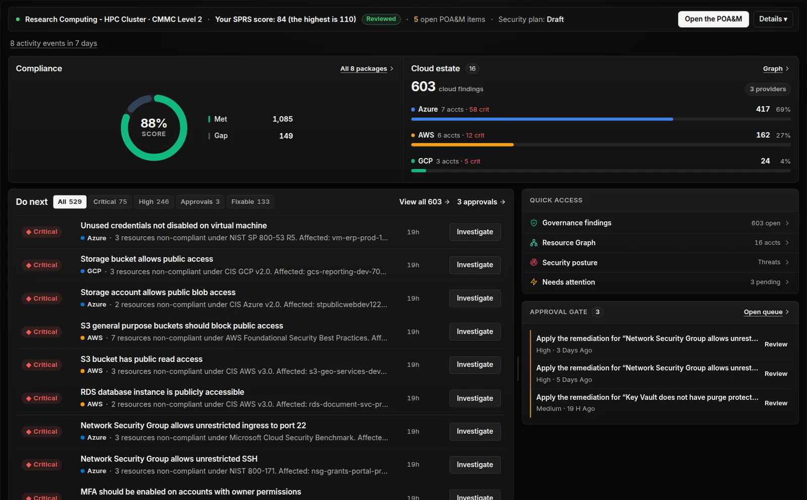
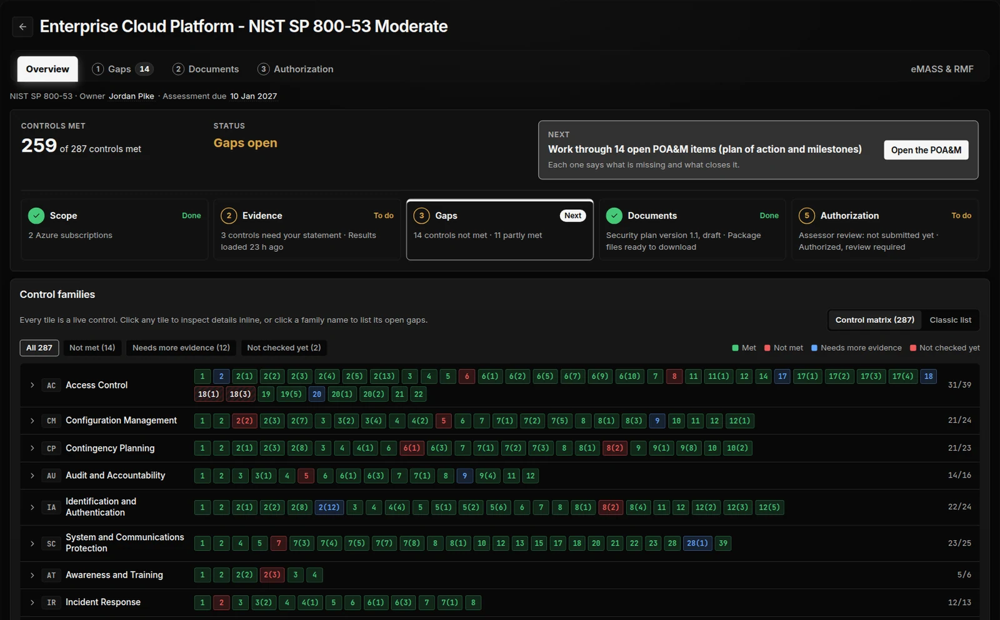

<div align="center">

<a href="https://policycortex.com">
  
</a>

<br><br>

<a href="https://policycortex.com"><b>Website</b></a>
&nbsp;&middot;&nbsp;
<a href="https://policycortex.com/platform/ato-authorization"><b>Continuous ATO</b></a>
&nbsp;&middot;&nbsp;
<a href="https://policycortex.com/solutions/nist-800-53"><b>NIST SP 800-53</b></a>
&nbsp;&middot;&nbsp;
<a href="https://policycortex.com/solutions/nist-800-171"><b>NIST SP 800-171 &amp; CMMC</b></a>
&nbsp;&middot;&nbsp;
<a href="https://policycortex.com/architecture"><b>Architecture</b></a>
&nbsp;&middot;&nbsp;
<a href="https://app.policycortex.com"><b>Platform Sign-In</b></a>

</div>

<br>

## One Detached System for Continuous RMF Authorization & Live Cloud Governance

**PolicyCortex** replaces legacy **eMASS** workflows and manual compliance spreadsheets across federal programs, national laboratories, and organizations that handle Controlled Unclassified Information (CUI). It unifies live multi-cloud governance (Azure, AWS, and GCP, with support for Azure Government, AWS GovCloud (US), and GCC High) and continuous Risk Management Framework (NIST SP 800-53, NIST SP 800-171, and CMMC) authorization in a single system.

| Capability | What PolicyCortex Delivers |
| :--- | :--- |
| **Proof of State** | Read-only cloud telemetry mapped across NIST SP 800-53, NIST SP 800-171, CMMC, and MITRE ATLAS. Missing observations are logged explicitly as declared gaps rather than silently omitted. |
| **Proof of Change** | Continuous posture evaluation that compiles unified **SSP**, **SAR**, and **POA&M** artifacts, **OSCAL 1.1.2** bundles, and **eMASS POA&M** worksheets from one live implementation record. |
| **Proof of Agency** | Operator-bounded remediation gated by approval policies, blast-radius limits, rollback, and emergency-stop controls. |
| **Detached Enclave & Offline Proof** | Installs inside the customer's own Azure Government, Azure Commercial, or Kubernetes boundary with **zero control-plane telemetry and zero evidence egress back to PolicyCortex** (also available U.S.-hosted). Every exported ATO package carries a **SHA3-256 hash-chained evidence stream** with an offline Python verifier. |

<br>

### Live Product Views (Synthetic Demo Workspace)

<table>
  <tr>
    <td width="50%" valign="top">
      <b>Multi-Cloud Governance &amp; Approval Gate</b><br>
      <sub>Live Azure, AWS, and GCP posture findings linked directly to SPRS readiness and gated remediation approvals.</sub><br><br>
      
    </td>
    <td width="50%" valign="top">
      <b>eMASS &amp; RMF Control Matrix</b><br>
      <sub>Live NIST SP 800-53 control matrix, 5-stage readiness rail, and unified SSP/SAR/POA&amp;M package export.</sub><br><br>
      
    </td>
  </tr>
</table>

### Independent Offline Evidence Verification

Any assessor or authorizing official can unzip an exported package offline and independently recompute its SHA3-256 evidence chain with no PolicyCortex account:

```text
$ python3 Evidence_History/verify_ledger.py Evidence_History/ledger.jsonl
PolicyCortex evidence stream verification (SHA3-256)
status: INTACT
ledger.json: sha3Chain head digest and counts match
Exit code: 0
```

### Security & Access

Because PolicyCortex is built for regulated cloud boundaries and federal authorization workflows, open public self-registration is intentionally disabled. Architecture walkthroughs and read-only evaluations are provisioned directly via **[policycortex.com](https://policycortex.com)** (response within one business day).

<div align="center">

<br>

**PolicyCortex** · Texas, USA · Live in production and in use with customers · Patent pending.

<a href="https://policycortex.com"><b>policycortex.com</b></a>
&nbsp;&middot;&nbsp;
<a href="mailto:esere@policycortex.com"><b>esere@policycortex.com</b></a>
&nbsp;&middot;&nbsp;
<a href="https://github.com/NijTeck"><b>Founder (@NijTeck)</b></a>

</div>
