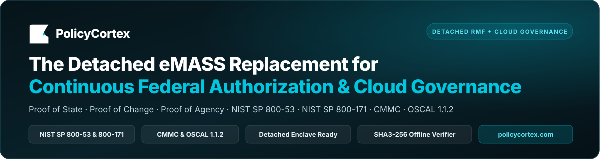
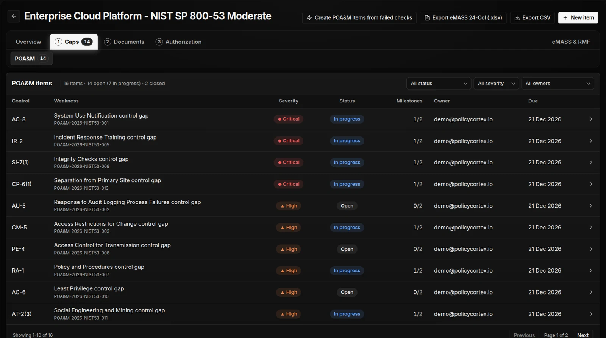
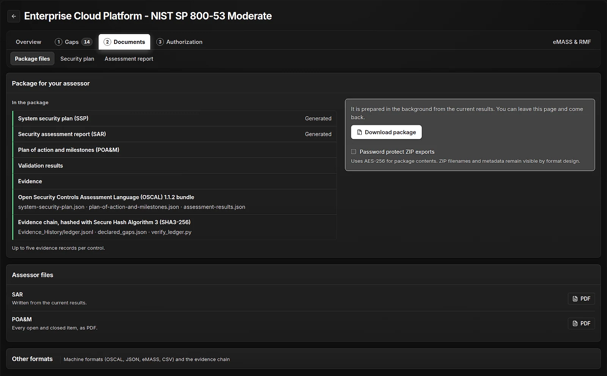

<div align="center">

<a href="https://policycortex.com">
  
</a>

<br><br>

<a href="https://policycortex.com"><b>Website</b></a>
&nbsp;&middot;&nbsp;
<a href="https://policycortex.com/platform/ato-authorization"><b>Continuous ATO</b></a>
&nbsp;&middot;&nbsp;
<a href="https://policycortex.com/solutions/nist-800-53"><b>NIST SP 800-53</b></a>
&nbsp;&middot;&nbsp;
<a href="https://policycortex.com/solutions/nist-800-171"><b>NIST SP 800-171 &amp; CMMC</b></a>
&nbsp;&middot;&nbsp;
<a href="https://policycortex.com/architecture"><b>Architecture</b></a>
&nbsp;&middot;&nbsp;
<a href="https://app.policycortex.com"><b>Platform Sign-In</b></a>

</div>

<br>

## One Detached System for Continuous RMF Authorization & Live Multi-Cloud Governance

**PolicyCortex** is built to replace legacy **eMASS** and fragmented compliance spreadsheets across federal programs, national laboratories, and organizations that handle Controlled Unclassified Information (CUI). Instead of bolting manual questionnaires onto cloud infrastructure, PolicyCortex unifies live multi-cloud governance (`Azure`, `AWS`, `GCP`, with support for `Azure Government`, `AWS GovCloud (US)`, and `GCC High`) and continuous Risk Management Framework (`NIST SP 800-53`, `NIST SP 800-171`, `CMMC`) authorization in a single system.

### Built Around Proof of State, Proof of Change, and Proof of Agency

| Capability | Architectural Implementation |
| :--- | :--- |
| **Proof of State** | `39` read-only cloud evidence collectors (`30` Azure, `9` AWS) plus GCP estate inventory mapped to `1,196` NIST SP 800-53 controls and enhancements, `110` NIST SP 800-171 requirements, and `66` MITRE ATLAS techniques. Missing observations are explicitly recorded as declared gaps. |
| **Proof of Change** | Continuous posture evaluation via **OPA (Open Policy Agent)**, **Steampipe**, and **Cloud Custodian**. Generates **SSP**, **SAR**, and **POA&M** documents, **OSCAL 1.1.2** JSON bundles, and **24-column eMASS POA&M (`.xlsx`)** exports from one live implementation record. |
| **Proof of Agency** | `49` typed remediation actions bounded by operator-set trust modes, human approval gates, a `0.9` confidence floor, blast-radius limits, rollback, and emergency-stop controls. |
| **Detached Enclave Deployment** | Installs directly inside the customer's own **Azure Government**, **Azure Commercial**, or **Kubernetes** boundary with **zero control-plane telemetry and zero evidence egress back to PolicyCortex**. Also offered as a U.S.-hosted service. |
| **Offline-Verifiable Packages** | Every exported ATO package ships with a **SHA3-256 hash-chained evidence stream** (`Evidence_History/ledger.jsonl`) and standalone offline verifier (`verify_ledger.py`) so any assessor or authorizing official can verify integrity without a PolicyCortex account. |

<hr>

### Live Platform Views (Synthetic Demo Workspace)

<table>
  <tr>
    <td width="50%" valign="top">
      <b>Multi-Cloud Governance &amp; Approval Gate Cockpit</b><br>
      <sub>Real-time Azure, AWS, and GCP findings linked directly to SPRS readiness and gated remediation approvals.</sub><br><br>
      
    </td>
    <td width="50%" valign="top">
      <b>eMASS &amp; RMF Control Matrix</b><br>
      <sub>Live 287-control NIST SP 800-53 Moderate matrix with 5-stage readiness rail (Scope, Evidence, Gaps, Documents, Authorization).</sub><br><br>
      
    </td>
  </tr>
  <tr>
    <td width="50%" valign="top">
      <b>Live POA&amp;M &amp; Native eMASS 24-Column Export</b><br>
      <sub>Generate POA&amp;M items directly from failed cloud checks and export native 24-column eMASS workbooks in one click.</sub><br><br>
      
    </td>
    <td width="50%" valign="top">
      <b>Assessor-Ready Package &amp; SHA3-256 Ledger</b><br>
      <sub>SSP, SAR, POA&amp;M, OSCAL 1.1.2 JSON bundles, declared gaps, and standalone offline verifier in one export.</sub><br><br>
      
    </td>
  </tr>
</table>

### Independent Offline Evidence Verification

Any authorizing official or third-party assessor can unzip an exported PolicyCortex ATO package on an offline workstation and recompute the entire SHA3-256 evidence chain:

```text
$ python3 Evidence_History/verify_ledger.py Evidence_History/ledger.jsonl
PolicyCortex evidence stream verification (SHA3-256)
stream: Evidence_History/ledger.jsonl
status: INTACT
headDigest: 9496e0defd46052a2285bfa9cdb68336eedb18f8ee6e622e8953caa690e866e9
records: 721 (state_capture 721, change_record 0, declared_gap 0, agency_record 0)
ledger.json: sha3Chain head digest and counts match
Exit code: 0
```

### Security & Evaluation Access

Because PolicyCortex is engineered for regulated cloud estates and federal authorization boundaries, open public self-registration is intentionally disabled. Platform access and isolated read-only demonstration walkthroughs are provisioned directly via **[policycortex.com](https://policycortex.com)** (response within one business day).

<div align="center">

<br>

**PolicyCortex** · Texas, USA · Live in production and in use with customers · Patent pending.

<a href="https://policycortex.com"><b>policycortex.com</b></a>
&nbsp;&middot;&nbsp;
<a href="mailto:esere@policycortex.com"><b>esere@policycortex.com</b></a>
&nbsp;&middot;&nbsp;
<a href="https://github.com/NijTeck"><b>Founder (@NijTeck)</b></a>

</div>
